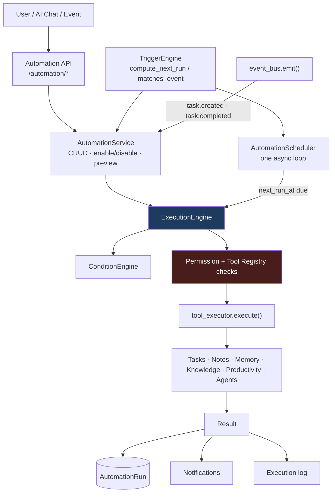
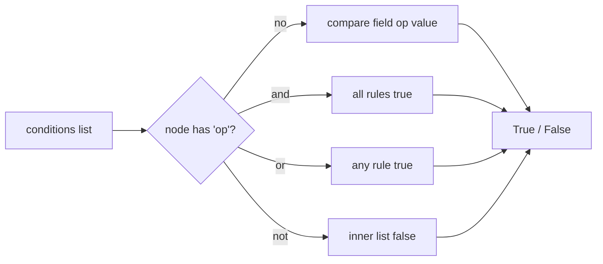
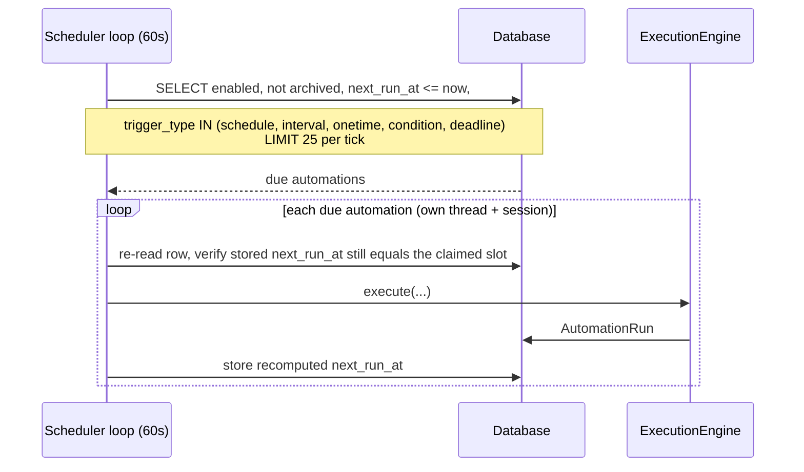
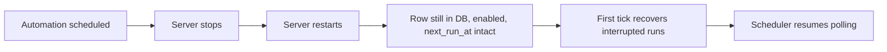
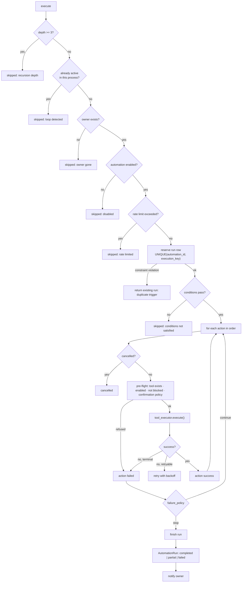
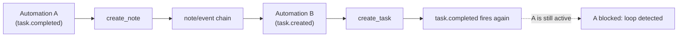
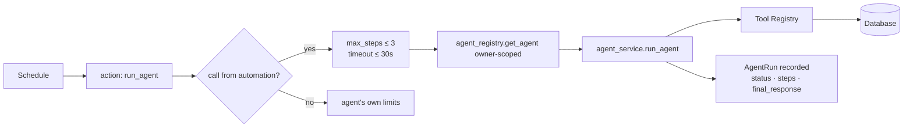

# RajOS V2 — Phase 9: Automation Engine 2.0

The Automation Engine lets RajOS execute controlled actions on the user's behalf
from schedules, recurring schedules, events, task deadlines, productivity
conditions, and user-defined triggers.

The engine does not replace any existing RajOS subsystem. It orchestrates them:
every automation action is executed **through the Phase 6 Tool Registry**, agents
run under the **Phase 7 agent limits**, productivity work uses the **Phase 8
productivity tools**, and the user is informed through the **existing
notification mechanism**.

```
User asks RajOS            Trigger occurs
      │                         │
      ▼                         ▼
Conversation / UI ─────► Automation Engine ─────► Tool Registry ─────► Action
                                │                                        │
                                └────────► Database · Notification · Log ◄┘
```

---

## 1. Automation architecture



Layers and their responsibilities:

| Layer | File | Responsibility |
|---|---|---|
| API | `app/automation/automation_router.py` | Authenticated HTTP surface, ownership enforcement |
| Service | `app/automation/automation_service.py` | CRUD, validation, preview, event dispatch, cancellation |
| Trigger engine | `app/automation/trigger_engine.py` | `next_run_at` computation, timezone handling, event matching |
| Condition engine | `app/automation/condition_engine.py` | Deterministic guard evaluation (no LLM) |
| Execution engine | `app/automation/execution_engine.py` | Runs actions through the Tool Registry with all safety gates |
| Scheduler | `app/automation/scheduler.py` | Single polling loop, restart recovery, deadline scanning |
| Event bus | `app/automation/event_bus.py` | Fail-safe domain-event emission |
| Tools | `app/automation/automation_tools.py` | `create_automation`, `send_notification`, `run_agent` |
| Legacy shim | `app/automation/workflow_engine.py` | Keeps the old `workflow_engine.execute()` callers working |

The scheduler **never** executes actions itself — it only calls
`execution_engine.execute(...)`.

---

## 2. AutomationDefinition

`app/automation/automation_models.py` — table `automations`.

| Column | Type | Notes |
|---|---|---|
| `id` | Integer PK | |
| `user_id` | Integer FK → `users.id` (CASCADE), indexed | **Required owner**; never from user input |
| `name` | String, NOT NULL | |
| `description` | String, nullable | |
| `trigger_type` | String, NOT NULL | `schedule` · `interval` · `onetime` · `event` · `condition` · `deadline` |
| `trigger_config` | JSON | Type-specific configuration |
| `conditions` | JSON | Condition rules / groups (see §4) |
| `actions` | JSON | Ordered action steps |
| `timezone` | String | IANA name, default `Asia/Kolkata` |
| `failure_policy` | String | `stop` (default) or `continue` |
| `max_retries` | Integer | Default 1, 0–5 |
| `retry_delay_seconds` | Float | Default 2.0, 0–300 |
| `enabled` | Boolean | Pause switch |
| `archived_at` | DateTime, indexed, nullable | Soft delete |
| `next_run_at` | DateTime(tz) | Persisted schedule state |
| `last_run_at` | DateTime(tz) | |
| `created_at` / `updated_at` | DateTime(tz) | |
| `trigger` / `action` | String, nullable | Legacy Phase 1 compatibility |

Legacy rows keep working: if `actions` is empty and the old `action` string is
set, the execution engine treats it as a single action.

`AutomationRun` — table `automation_runs` — one row per execution (§9).

---

## 3. Trigger system

`TriggerEngine` in `app/automation/trigger_engine.py`.

| Type | `trigger_config` | Meaning |
|---|---|---|
| `schedule` | `{"time": "08:00", "days": ["mon","tue",…]}` or `{"time":"09:00","day_of_month":1}` | Daily / weekday / monthly at a **local** time |
| `interval` | `{"interval_minutes": 120}` | Every N minutes |
| `onetime` | `{"run_at": "2026-12-31T19:00:00"}` | Fires once, then auto-disables |
| `event` | `{"event_type": "task.completed"}` | Fired by the event dispatcher |
| `condition` | `{"poll_minutes": 15}` + `conditions` | Polled; runs only when its guards hold |
| `deadline` | `{"deadline_hours": 24, "poll_minutes": 15}` | Fires for each task entering the N-hour window before its due date |

`compute_next_run()` returns a timezone-aware UTC datetime (or `None` for event
triggers, which are not time-based). `SCHEDULER_TRIGGER_TYPES` is the set the
scheduler polls; `event` is deliberately excluded.

`matches_event()` matches an event against `trigger_config.event_type` — exact
string equality, no pattern language.

### Validation

`TriggerEngine.validate()` rejects, at create/update time:

* unknown `trigger_type`
* unknown / unloadable timezone
* `schedule` without `time`, or a `time` that is not `HH:MM`
* unknown weekday names, `day_of_month` outside 1–31
* `interval_minutes` missing or ≤ 0
* `onetime` without a parseable `run_at`
* `event` without `event_type`
* `deadline_hours` ≤ 0

---

## 4. Conditions

`ConditionEngine` — **deterministic backend evaluation, never an LLM**.

Available fields: `overdue_tasks`, `pending_tasks`, `completed_tasks`,
`total_tasks`, `day_of_week`, `hour_of_day`, all derived from the owner's own
tasks only.

Operators: `==` `!=` `>` `<` `>=` `<=` `in` `not_in` `contains`.

A flat list is implicitly **AND**-ed (backward compatible). Nested groups add
`and` / `or` / `not`:

```json
[
  {"op": "and", "rules": [
    {"field": "overdue_tasks", "operator": ">", "value": 0},
    {"op": "not", "rules": [
      {"field": "day_of_week", "operator": "==", "value": "sun"}
    ]}
  ]}
]
```



Rules:

* Group nesting is capped at **3 levels** (`_MAX_GROUP_DEPTH`) — no unbounded trees.
* `validate()` rejects unknown fields, unknown operators, missing values, empty
  groups and excessive depth. An invalid tree is refused at the API (HTTP 422).
* Evaluation **fails closed**: if a tree somehow reaches evaluation invalid, it
  evaluates to `False`, never `True`.
* An empty condition list is vacuously true.

---

## 5. Scheduler

`app/automation/scheduler.py` — **one centralized loop**, never one loop per
automation. It is started from the FastAPI startup hook in `app/main.py` and
stopped on shutdown.



Key properties:

* Ticks every 60 s; at most `_MAX_RUNS_PER_TICK = 25` runs per tick.
* Each run gets **its own thread and its own database session**
  (`asyncio.to_thread`) so a slow action cannot block the API event loop.
* Stale-claim protection: before running, the row is re-read and the slot
  compared; if another worker already advanced `next_run_at`, the tick skips it.
* `next_run_at` is **always** advanced after an attempt, so a permanently failing
  automation can never hot-loop.
* `onetime` automations are disabled after firing.
* `condition` automations record a run only when their guards pass.
* `deadline` automations scan the owner's tasks for ones entering the
  `deadline_hours` window and fire once per `(task, due_date)` pair.

### Restart behaviour

All schedule state lives in the database (`next_run_at`, `trigger_config`,
`enabled`, `archived_at`), so nothing is lost when the process dies. On the first
tick after startup, `_recover_interrupted_runs()` marks runs left in `running`
by a crash as `failed` with `"Interrupted by server restart."`, so history never
shows a permanently-running run.



---

## 6. Execution engine

`ExecutionEngine.execute()` — the only path that runs actions.



### Statuses

`running` · `completed` · `partial` · `failed` · `skipped` · `cancelled`

`completed` only when every attempted action succeeded. If some succeeded and
some failed the run is `partial`; if nothing succeeded it is `failed`. An
automation is never reported successful when an important action failed.

### Failure policy

* `stop` (default) — the first failed action aborts the remaining actions.
* `continue` — every action is attempted; the outcome is `partial`/`failed`.

The exact per-action outcome is recorded in `AutomationRun.execution_log`
(`step`, `tool_name`, `status`, `duration_ms`, `attempts`, `error`,
`error_code`, and the tool result).

### Cancellation

`POST /automation/{id}/cancel` marks the automation's in-flight run as
`cancelled` in the database, and the engine re-checks the persisted run status
**before every action**, so remaining actions are skipped and the run is
recorded as `cancelled`. A stale in-process cancel flag is discarded at the
start of each run and can never leak into the next one.

---

## 7. Idempotency

`AutomationRun.execution_key` plus the database constraint
`UNIQUE (automation_id, execution_key)` (`uq_automation_runs_automation_execution_key`)
is the whole mechanism.

| Trigger | Execution key |
|---|---|
| Scheduler slot | `schedule:{slot_iso}` |
| Condition poll | `condition:{slot_iso}` |
| Deadline | `deadline:{task_id}:{due_iso}` |
| Event | `event:{type}:{event_id}` |
| Manual "Run Now" | `manual:{uuid4}` (always distinct) |

The run row is created **before** any action executes, so two workers observing
the same trigger race on an INSERT: one wins, the other gets an
`IntegrityError` and returns the existing run instead of executing twice. This
covers worker restarts, scheduler retries, delayed ticks and network
interruptions.

---

## 8. Retries

Per-automation configuration (`max_retries` 0–5, `retry_delay_seconds` 0–300),
applied inside a single action with exponential backoff.

Retried (genuinely transient): `EXECUTION_FAILED`, `TIMEOUT`, `RATE_LIMITED`.

**Never retried:**

* `PERMISSION_DENIED`
* `INVALID_ARGUMENTS`
* `TOOL_NOT_FOUND` / `TOOL_DISABLED` / `RESOURCE_NOT_FOUND`
* `CONFIRMATION_REQUIRED`
* blocked or disabled tools (refused in pre-flight, executor is never called)
* user cancellation

---

## 9. Execution records

`automation_runs` (model `AutomationRun`):

| Column | Notes |
|---|---|
| `id` | UUID string PK |
| `automation_id` | FK → `automations.id` |
| `user_id` | FK → `users.id`, indexed |
| `execution_key` | Idempotency key, indexed, part of the unique constraint |
| `status` | `running` · `completed` · `partial` · `failed` · `skipped` · `cancelled` |
| `trigger_source` | `scheduler` · `manual` · `event:{type}` · `deadline:task:{id}` |
| `actions_attempted` / `actions_completed` | Counters |
| `execution_log` | Per-action JSON log |
| `error_message` | Safe, user-facing message — never a stack trace |
| `started_at` / `completed_at` | Timestamps |

Stored action **arguments** are never persisted; only the outcome of each action.
No credentials or provider secrets ever reach a run record, an execution log or a
notification. History is preserved when an automation is deleted (§13).

---

## 10. Permissions and confirmation

Every run re-checks, at execution time, that the owner still exists, that the
automation still belongs to them, that it is still enabled, that each tool still
exists and is still enabled, that its arguments validate, and that its
confirmation policy is satisfied. Permissions granted when the automation was
created are **not** assumed to still be valid.

```
Automation → Permission checks → Tool Registry → Tool argument validation → Tool execution
```

* Ownership is always derived from `context.user_id` (the authenticated user).
  `user_id`, `owner_id`, `owner` and `conversation_id` in stored action
  arguments are **stripped** before execution.
* The execution context carries `permissions=["*"]`, i.e. the owner acting as
  themselves; the Tool Registry still enforces each tool's
  `required_permissions`.
* The engine keeps its own deny-list (`AUTOMATION_BLOCKED_TOOLS`) as defence in
  depth **in addition** to the registry: `run_shell`, `execute_shell`, `bash`,
  `execute_sql`, `run_sql`, `execute_python`, `run_python`, `eval`, `exec`,
  `read_file`, `write_file`, `delete_file`, `filesystem`, `http_request`,
  `network_request`, `webhook`.
* Tools with `requires_confirmation` (e.g. `delete_task`, `delete_note`,
  `forget_memory`) are **refused at creation** unless the user explicitly set
  `confirmation_policy: "preapproved"` on that action. There is no path that
  lets an LLM or a stored definition silently bypass confirmation.
* `create_automation` itself is registered as `requires_confirmation = True`, so
  the AI cannot silently commit a recurring action (Phase 6 confirmation flow).
* Creation-time validation rejects unknown, disabled, blocked and
  unapproved-destructive tools with HTTP 422, so a broken definition never gets
  saved and then fail on every future run.

### Automation actions available

Any Tool Registry tool that is not blocked and is enabled can be used, including:
`create_task`, `update_task`, `complete_task`, `create_note`, `search_notes`,
`remember`, `search_memory`, `search_knowledge`, `search_workspace`,
`get_productivity_summary`, `get_daily_brief`, `get_weekly_summary`,
`get_overdue_tasks`, `get_due_soon_tasks`, `get_task_recommendations`,
`plan_tasks`, `get_workload`, `get_productivity_trends`, `send_notification`,
`run_agent`, plus the confirmation-gated destructive tools.

### User isolation

`user_id` from the request body is ignored entirely. Every query is filtered by
the authenticated user, including run history (which stays readable for an
archived automation, but only by its owner). A second user receives `404`
(not `403`) for someone else's automation, so ids are not enumerable.

---

## 11. Recursion and loop protection



Three independent safeguards:

1. **Re-entrancy guard** — `_ACTIVE_RUNS` blocks an automation from executing
   while one of its own runs is in flight (the direct A → … → A loop).
2. **Depth cap** — `_MAX_DEPTH = 3`. The depth is carried through the execution
   stack in a `ContextVar`, so chained executions inflate it. A run at or beyond
   the cap is persisted as `skipped` with `"Blocked: max recursion depth 3
   reached."` and no action executes.
3. **Burst rate limiting** — an automation may start at most
   `_MAX_RUNS_PER_WINDOW = 30` runs within `_RATE_WINDOW_SECONDS = 60` seconds.
   Excess attempts are recorded as `skipped` with a `"Rate limited: …"` reason,
   so a hundred identical events cannot produce a hundred AI runs.

Chains always terminate and every blocked attempt leaves an auditable record.
The rate limiter is process-local (see §23).

---

## 12. Event system

`app/automation/event_bus.py` is a thin, fail-safe wrapper:

```python
event_bus.emit(db, user_id=..., event_type="task.completed",
               payload={"task_id": id}, event_id=f"task.completed:{id}")
```

* Emitted today by the task router and the task tools: `task.created`,
  `task.completed`.
* `event_id` makes delivery idempotent — replaying an event never re-runs an
  automation.
* Delivery is **best effort and never breaks the caller**: failures are logged
  and swallowed, so a task is never lost because an automation misbehaved.
* The payload is **not trusted**: it is used only as opaque context; ownership
  always comes from the emitting `user_id`, and the payload cannot influence
  permissions, tool choice or arguments.
* The API surface (`POST /automation/event`) accepts `type` (max 120 chars) and
  an optional payload; it never accepts an `event_id`, so callers cannot forge
  another user's idempotency key. Events are dispatched only to the
  authenticated user's own automations.

Not every database write emits an event — only the meaningful transitions above.

---

## 13. Automation management API

All endpoints require authentication (`get_current_user`) and are scoped to the
authenticated owner.

| Method | Path | Purpose |
|---|---|---|
| `POST` | `/automation/` | Create (validates trigger, conditions and actions) |
| `GET` | `/automation/` | List own, non-archived automations |
| `GET` | `/automation/{id}` | Get one |
| `PUT` | `/automation/{id}` | Update (same validation; recomputes `next_run_at`) |
| `DELETE` | `/automation/{id}` | Archive — history preserved |
| `POST` | `/automation/{id}/enable` | Enable + recompute `next_run_at` |
| `POST` | `/automation/{id}/disable` | Disable (ignored by the scheduler) |
| `POST` | `/automation/{id}/run` | Manual run — **same** pipeline as the scheduler |
| `POST` | `/automation/{id}/cancel` | Cancel the in-flight run |
| `GET` | `/automation/{id}/runs` | Execution history (readable after archive) |
| `GET` | `/automation/{id}/preview` | Next run + planned actions + conditions |
| `POST` | `/automation/preview` | Validate + preview a **draft** without saving |
| `POST` | `/automation/event` | Fire an event for the current user |
| `POST` | `/automation/{id}/execute` | Legacy alias for `/run` |

Deleting archives (`archived_at` set, `enabled = False`): the automation leaves
the list and is never executed again, while `GET /{id}/runs` keeps returning its
full history.

---

## 14. Agent integration

An automation can call the `run_agent` tool. The agent then still obeys all of
its Phase 7 controls — capabilities, `allowed_tools`, `max_tool_calls`,
confirmation policy and user ownership — and additionally:



* `_AUTOMATION_MAX_STEPS = 3`, `_AUTOMATION_TIMEOUT_SECONDS = 30` — an
  automation can only **tighten** the agent's limits, never loosen them
  (`max_steps_override` and `timeout_seconds_override` are clamped with `min`).
* The agent must belong to the user (`agent_registry.get_agent(..., user_id)`),
  must be enabled, and a disabled or foreign agent fails safely.
* The existing step cap, tool-call cap, repeated-call loop detector and
  `AgentRun` record all still apply.
* Combined with the execution depth cap, this makes an unbounded autonomous
  agent loop impossible: an automation-triggered agent cannot recursively
  trigger its own automation.

---

## 15. Productivity integration

The engine consumes Phase 8 through the Tool Registry instead of duplicating it.
Useful automations that work today:

| Automation | Trigger | Actions |
|---|---|---|
| **Daily brief** | `schedule` weekdays 08:00 | `list_tasks` → `get_daily_brief` → `send_notification` |
| **Weekly review** | `schedule` sun 19:00 | `get_weekly_summary` → `get_productivity_trends` → `send_notification` |
| **Overdue review** | `schedule` daily 18:00, condition `overdue_tasks > 0` | `get_overdue_tasks` → `send_notification` |
| **Deadline reminder** | `deadline` 24 h | `get_task` / `send_notification` |
| **Workload check** | `condition` `pending_tasks > 10` | `get_workload` → `send_notification` |

`get_due_soon_tasks`, `get_task_recommendations`, `plan_tasks`, `break_down_task`
and `get_productivity_summary` are available as actions too. Deadline scans read
`Task.due_date`, which RajOS stores as naive UTC; the scheduler compares using
that same convention so a reminder window is never off by a timezone offset.

---

## 16. Notifications

Notifications go through the **existing** `app.notifications.notification_manager.NotificationManager`
(`send_task_reminder`) — no second notification engine was created.

* The execution engine notifies the owner after a `completed`, `partial`,
  `failed` or `cancelled` run.
* `skipped` runs are not notified (they did not do anything).
* A notification failure is logged and **never** changes the run outcome.
* `User.notifications_enabled = False` suppresses everything.
* The `send_notification` tool is also available as a normal automation action;
  it returns `{"status": "skipped", "reason": "notifications_disabled"}` when the
  user has notifications off.
* Delivery channels remain whatever the existing notification architecture
  supports (SMS/push service stubs). No email/SMS/push provider was added.

---

## 17. Frontend

`frontend/services/api/automation.ts` — typed client for every endpoint
(`listAutomations`, `createAutomation`, `updateAutomation`, `deleteAutomation`,
`enableAutomation`, `disableAutomation`, `runAutomation`, `cancelAutomation`,
`getAutomationRuns`, `previewAutomation`, `previewDraftAutomation`, `fireEvent`),
with a shared error formatter that turns FastAPI validation arrays into readable
messages.

`frontend/app/automation/page.tsx`:

* Stats row (total / active / paused) and a refresh button.
* Automation list showing **name, status, trigger, timezone, conditions, actions
  in order, next run and last run**.
* Enable/disable switch, **Run Now** (which switches to **Cancel** while a run
  is in flight), **Edit** (inline name / time / timezone → `PUT`), and delete
  with a confirmation prompt.
* Expandable **execution history** per automation with status markers for
  completed / failed / partial / running / cancelled / skipped, action counts,
  the safe `error_message`, the trigger source and the time.
* Create workflow: **Name → Trigger (type, schedule/interval/event/one-time/
  deadline config) → Timezone → Action → Review & create**, which calls
  `POST /automation/preview` and shows the structured interpretation (name,
  trigger, timezone, ordered actions, next run, failure policy) before the user
  commits. The backend re-validates on create — the preview is a heads-up, not
  the source of truth.
* Loading skeletons, an empty state, an error banner, and responsive
  layout consistent with the existing pages. No other page was modified.

---

## 18. Database

Two migrations exist; both are additive.

* `alembic/versions/b7f3c1d92a45_add_phase8_task_productivity_fields.py` (Phase 8)
* `alembic/versions/c4e8a1f6b2d7_add_phase9_automation_engine_2.py` (Phase 9)

The Phase 9 migration adds the `automations` columns listed in §2,
`automation_runs.execution_key`, the unique index
`uq_automation_runs_automation_execution_key`, and the `user_id` / `archived_at`
indexes. It is written defensively: each column and index is checked with an
inspector and skipped when it already exists.

`app/database/schema_sync.py` runs at startup **after**
`Base.metadata.create_all` and closes the gap for an existing database:
`create_all` never alters an existing table, so a database created by an earlier
release would otherwise lack the newer columns. `sync_schema()` only

* creates missing tables,
* adds missing columns (`ALTER TABLE … ADD COLUMN`, with a type-appropriate
  `NOT NULL DEFAULT`),
* creates the required unique index,

and **never** drops, renames or rewrites anything. Every change is logged. No
data is destroyed and no database is reset; the existing `rajos.db` is
preserved and upgraded in place.

---

## 19. Security review

| Area | Control |
|---|---|
| Authentication | Every `/automation/*` endpoint depends on `get_current_user`; unauthenticated calls get 401/403 |
| Authorization | All reads/writes filter on the authenticated `user_id`; foreign ids return 404 |
| Ownership | Server-supplied only. `user_id` in a request body is ignored; `user_id`/`owner_id`/`conversation_id` in stored action arguments are stripped |
| Tool permissions | Every action goes through `tool_executor.execute()`; no bypass path exists |
| Agent permissions | `run_agent` resolves the agent through `agent_registry.get_agent(..., user_id)`, so foreign or disabled agents cannot run |
| Input validation | Trigger, timezone, conditions, actions and arguments are validated at create **and** update; the preview endpoint uses the same validation |
| Confirmation | Destructive tools are refused unless explicitly pre-approved; `create_automation` itself requires confirmation |
| Prompt injection | Retrieved/AI content cannot redefine permissions: automations are stored as validated structured data, the AI only proposes via a confirmation-gated tool, and neither event payloads nor retrieved documents are read as instructions |
| Secrets | No credentials are stored on, or exposed by, automation definitions, run records or logs; provider credentials never leave the LLM layer |
| External actions | Externally visible actions (`send_notification`, destructive tools) require either confirmation or explicit pre-approval |
| Recursion | Depth cap, re-entrancy guard and burst limiting (§11) |
| Data exposure | `error_message` is user-facing prose — no stack traces reach the UI |

---

## 20. Testing

`tests/test_automation.py` — **152 tests**, all passing. The whole backend suite
reports **216 passed**.

| Test class | Tests | Covers |
|---|---|---|
| `TestCreationValidation` | 17 | Valid creation; missing/blank name; invalid trigger type, schedule time, weekday, timezone, failure policy; unknown/blocked/destructive tool; condition field/operator/depth rejection; accepted condition group |
| `TestConditionGroups` | 15 | AND / OR / NOT, nesting, flat+group mix, validation errors, depth limit, fail-closed evaluation, per-user context isolation |
| `TestTriggerEngine` | 13 | Daily/weekday schedules, interval, one-time past/future, event matching, deadline window, invalid input |
| `TestAutomationAPI` | 12 | Full HTTP CRUD, enable/disable, run, history, preview, event, unauthenticated |
| `TestUserIsolation` | 11 | Second user blocked from read/update/delete/run/cancel/toggle/history; list isolation; events scoped; `user_id` spoofing ignored |
| `TestConditionEngine` | 11 | Every operator, multi-condition AND, unsupported field |
| `TestSchedulerBehaviour` | 9 | Due execution, schedule advance, missed run without hot-looping, disabled + event + archived skip, one-time auto-disable, restart persistence, interrupted-run recovery, deadline idempotency |
| `TestAutomationService` | 8 | CRUD, cross-user `get_one`, enable/disable, preview, event dispatch |
| `TestNotificationIntegration` | 7 | Completion / failure / partial notifications, notification failure isolation, notifications disabled, `send_notification` tool |
| `TestExecutionEngine` | 7 | Disabled skip, no actions, success, stop/continue policy, recursion block, condition gate |
| `TestDeleteAndHistory` | 6 | Delete archives but preserves history; edit preserves history & id; invalid edit rejected; disable/enable keeps history; draft preview validates without saving |
| `TestCancellation` | 6 | Mid-run cancel stops remaining actions, no flag leakage, cancelled status persisted & visible, cross-worker signal, endpoint with nothing in flight, stuck run marked cancelled |
| `TestAgentIntegration` | 6 | Automation → agent → tool → DB; stricter step cap (5 → 3); allowed-tools still enforced; disabled agent; foreign agent; `agents.run` permission |
| `TestTimezoneScheduling` | 5 | Local time → UTC conversion, DST (EST/EDT) handling, naive one-time in automation timezone, invalid timezone/trigger rejection |
| `TestToolPermissionEnforcement` | 4 | Disabled tool refused at creation and at run; blocked tool never reaches the executor; owner-argument injection stripped |
| `TestAutomationSafety` | 4 | Destructive tool refused without pre-approval; pre-approved bypasses the gate; confirmation error not retried; malformed action list rejected |
| `TestRetries` | 3 | Transient failure retried with backoff; permission denial not retried; missing tool not retried |
| `TestRecursionProtection` | 3 | Self-triggering automation blocked; two automations bounded; depth cap blocks deep chains |
| `TestRateLimiting` | 3 | Burst capped, reason recorded, per-automation budgets |
| `TestIdempotency` | 2 | Same execution key runs once; distinct keys run separately |

`tests/conftest.py` points the application engine (tools, scheduler, background
threads) at a throw-away temp-file database, so tests never touch `./rajos.db`.

### Live end-to-end verification

The full flow was exercised over HTTP against a running `uvicorn` server on a
temporary database — **40/40 checks passed**:

* create a one-time and a recurring automation; next run = 08:00 Asia/Kolkata,
  stored as UTC
* disable → re-enable (next run recomputed)
* Run Now → 3/3 actions completed → history readable
* a failing action → `failed`, safe error message, no stack trace
* `run_shell`, unapproved `delete_task`, unknown tool, invalid timezone and
  invalid condition all rejected with 422
* `run_agent` with an unknown agent fails safely
* condition-guarded run skipped with `"Conditions not satisfied."`
* the scheduler fired a due one-time automation **with no API call**
  (`trigger_source=scheduler`) and the one-time automation disabled itself
* a second user saw an empty list and got 404 on every attempt
* backend restart → all automations, schedules and history intact
* delete → archived, gone from the list, history preserved

Frontend: `tsc --noEmit` clean, `next lint` clean, `next build` succeeds for
every route.

---

## 21. Configuration reference

| Constant | Value | Location |
|---|---|---|
| `_POLL_INTERVAL` | 60 s | `scheduler.py` |
| `_MAX_RUNS_PER_TICK` | 25 | `scheduler.py` |
| `_MAX_DEPTH` | 3 | `execution_engine.py` |
| `_MAX_RUNS_PER_WINDOW` | 30 | `execution_engine.py` |
| `_RATE_WINDOW_SECONDS` | 60 | `execution_engine.py` |
| `_DEFAULT_POLL_MINUTES` | 15 | `trigger_engine.py` |
| `_MAX_GROUP_DEPTH` | 3 | `condition_engine.py` |
| `_AUTOMATION_MAX_STEPS` | 3 | `automation_tools.py` |
| `_AUTOMATION_TIMEOUT_SECONDS` | 30 | `automation_tools.py` |
| default `timezone` | `Asia/Kolkata` | model / schema |
| default `max_retries` / delay | 1 / 2.0 s | model / schema |
| default `failure_policy` | `stop` | model / schema |

---

## 22. Natural-language creation

The AI Core can create automations through the `create_automation` tool, which
accepts a fully structured proposal (`name`, `trigger_type`, `trigger_config`,
`conditions`, `actions`, `timezone`, `failure_policy`).

```
"Remind me every morning at 8 AM to check my tasks."
        │
        ▼
AI proposes:  name="Morning Task Review"
              trigger=schedule 08:00
              timezone=Asia/Kolkata
              actions=[get_daily_brief, send_notification]
        │
        ▼
Phase 6 confirmation prompt  →  user confirms / edits / cancels
        │
        ▼
create_automation → AutomationService.create() → re-validated server-side
```

Because the tool is registered with `requires_confirmation = True`, the AI can
never silently commit a recurring or destructive automation. Ownership comes
from the authenticated tool context, never from the model's output. The user's
existing automations can then be managed conversationally
("pause my morning reminder" → disable, "what automations ran today?" →
`GET /automation/{id}/runs`).

---

## 23. Known limitations and future improvements

Honest limitations of the current implementation:

* **Rate limiting and loop detection are process-local.** They use module-level
  state, so with multiple worker processes each worker has its own budget. The
  database unique constraint still guarantees at-most-once execution per
  trigger; a shared store (Redis) would make the rate limiter global.
* **Cancellation is best-effort within one process.** Cross-process cancellation
  works through the persisted run status, but a worker already inside a single
  long-running tool call cannot be interrupted mid-call.
* **Conditions only read task aggregates.** No note/memory/document fields, and
  no cross-automation state.
* **Only `task.created` and `task.completed` are emitted.** Notes, documents,
  conversations and agent runs do not yet emit events.
* **No cron expression support** even though `TriggerConfig.cron` exists in the
  schema as a placeholder for future use.
* **Every action is a Tool Registry tool.** There is no scripting, webhook or
  arbitrary-code action, by design.

Natural next steps: a shared rate-limit/loop store, more emitted domain events,
richer condition fields, `day_of_month`-relative scheduling, notification
channel selection (Phase 8+ already has the plumbing), and per-automation usage
budgets once AI usage tracking is exposed.

---

## 24. Phase 10 readiness

Phase 9 leaves the following in place for **Phase 10 — Search & Unified
Workspace**:

* A **persistent, queryable execution history** (`automation_runs` with status,
  trigger source, counters, per-action log) that a unified workspace can surface
  as activity.
* An **event bus** (`event_bus.emit`) that already carries `task.created` and
  `task.completed` with user ownership and an idempotency id — the natural place
  to hang search indexing and workspace activity feeds.
* **`search_workspace`** is registered in the Tool Registry, so automations can
  already drive workspace-wide search as an action.
* Clean **service boundaries** (`AutomationService` for reads/writes,
  `ExecutionEngine` for execution) so workspace endpoints can compose automation
  data without touching internals.
* **Validation-at-the-edge** patterns and ownership derivation that new
  workspace/search endpoints should follow.
* A frontend **typed API client + live page** pattern that new workspace views
  can mirror.
